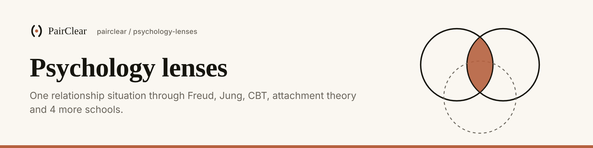
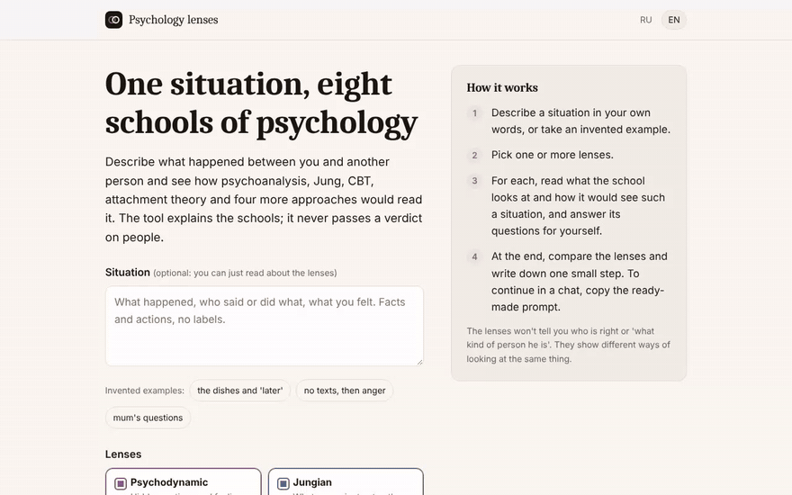
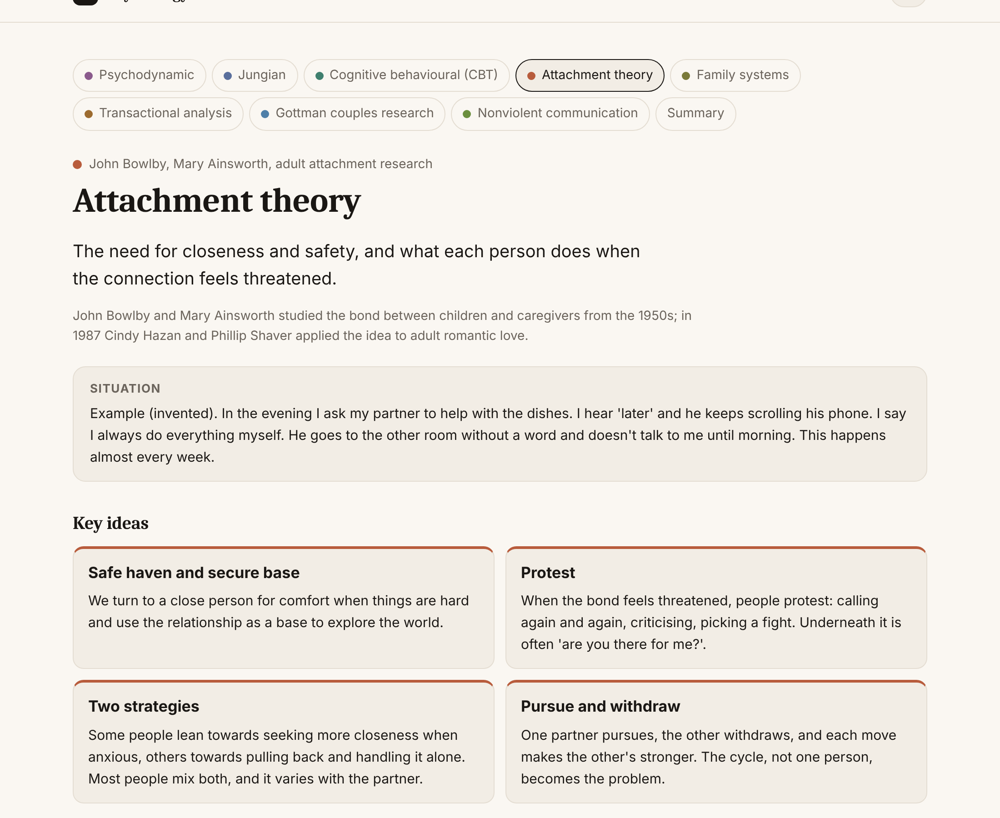

<a href="https://pairclear.github.io/psychology-lenses/"><picture>
  <source media="(prefers-color-scheme: dark)" srcset="assets/banner-dark.png">
  
</picture></a>

# Psychology lenses: see one situation through Freud, Jung, CBT and 5 more schools

**[Open the tool →](https://pairclear.github.io/psychology-lenses/?lang=en)** · [Русская версия](README.ru.md) · [ChatGPT prompts](prompts/en/) · [Claude skill](SKILL.md)

    

> **Education, not diagnosis.** The lenses explain how a school of psychology would look at a situation. They do not diagnose, label or judge you or anyone else, and they do not replace a professional. If you are thinking about hurting yourself, or there is violence at home, call emergency services (112 in Europe, 911 in the US and Canada) or find a free helpline at [findahelpline.com](https://findahelpline.com).

## See it in action

**[Try it in your browser →](https://pairclear.github.io/psychology-lenses/?lang=en)** No install, nothing is sent anywhere.

People often ask a chatbot "analyse this through Freud" or "what would Jung say about my relationship". This repo makes that question honest and useful: you describe what happened between you and another person, and each lens shows what its school looks at, how it would read such a situation, which questions it would ask you, and where it falls short.

## The eight lenses

| Lens | What it looks at | Prompt |
|---|---|---|
| Psychodynamic (Freud and after) | Hidden motives and feelings, old relationship patterns replaying now | [EN](prompts/en/psychodynamic.md) · [RU](prompts/ru/psychodynamic.md) |
| Jungian | Projection, the shadow, the roles we wear | [EN](prompts/en/jungian.md) · [RU](prompts/ru/jungian.md) |
| Cognitive behavioural (CBT) | Situation → thought → feeling → action, thinking traps | [EN](prompts/en/cbt.md) · [RU](prompts/ru/cbt.md) |
| Attachment theory | The need for closeness and safety, pursue-and-withdraw cycles | [EN](prompts/en/attachment.md) · [RU](prompts/ru/attachment.md) |
| Family systems | Roles, triangles, patterns across generations | [EN](prompts/en/family-systems.md) · [RU](prompts/ru/family-systems.md) |
| Transactional analysis | Parent, Adult, Child; "games"; the drama triangle | [EN](prompts/en/transactional-analysis.md) · [RU](prompts/ru/transactional-analysis.md) |
| Gottman couples research | How a couple's conversation starts, harmful patterns, repair | [EN](prompts/en/gottman.md) · [RU](prompts/ru/gottman.md) |
| Nonviolent communication | Observations, feelings, needs, requests | [EN](prompts/en/nvc.md) · [RU](prompts/ru/nvc.md) |
| **All lenses, compared** | Picks 2–3 fitting lenses and compares their readings | [EN](prompts/en/all-lenses.md) · [RU](prompts/ru/all-lenses.md) |

Every lens lists its **limits and criticism** and its sources. A lens is a way of looking, not a fact about you.

## Quick start

- **In the browser:** open [the tool](https://pairclear.github.io/psychology-lenses/?lang=en). Describe a situation (or take an invented example), pick lenses, answer the questions.
- **Straight to one lens:** add `?lens=cbt` (or `psychodynamic`, `jungian`, `attachment`, `family-systems`, `transactional-analysis`, `gottman`, `nvc`).
- **Offline:** download `index.html` and open it.
- **In a chat:** copy a prompt from [`prompts/en/`](prompts/en/) into ChatGPT, Claude, Gemini or any other chat. Or press "Prompt" in the tool: it copies the lens together with your situation and answers.
- **As a skill:** drop [`SKILL.md`](SKILL.md) into your Claude skills or agent setup.

## Built-in guardrails

Every prompt and the skill tell the chat to:

- explain the school, never judge the person: no diagnoses and no labels like "narcissist", "toxic", "codependent";
- not judge people who are not in the conversation: "is my husband a narcissist?" is turned into "what does he actually do, and what are my options?";
- frame every reading as a hypothesis and drop it if you say it does not fit;
- never advise leaving or staying;
- treat violence, threats and control as a safety issue, not a "dynamic both people create";
- stop and point to real help if you mention self-harm or suicide.

The web tool also notices labels and danger words **locally, in your browser** and shows a gentle note: describe actions instead of labels, or take care of your safety first.

## Privacy

Everything runs in your browser. The page makes no network requests, has no analytics, no cookies and no third-party fonts. Your situation and answers are kept only in your browser's local storage, and one button erases them.

## Repo layout

| Path | What it is |
|---|---|
| [`lenses.json`](lenses.json) | All lens texts in RU and EN: the single source of truth |
| [`index.html`](index.html) | The tool: one generated HTML file, no dependencies |
| [`prompts/`](prompts/) | Generated prompts, one per lens plus a comparison prompt |
| [`SKILL.md`](SKILL.md), [`AGENTS.md`](AGENTS.md) | The lenses as a skill for Claude and other agents |
| `src/`, `scripts/build.mjs` | Page template, shared prompt texts, build script |

To change a text, edit `lenses.json` or `src/`, then run `node scripts/build.mjs` (Node 18+, no packages).

## FAQ

**Can it tell me if my partner is a narcissist?** No, and nothing honest can from a story. It can help you describe what happens, see it from several angles and think about your options.

**Which lens is right?** None of them is "the truth". They look at different levels: inner world, thoughts, need for closeness, the family system, the way you talk. Seeing where they agree is often the most useful part.

**Is this therapy?** No. It is a reading aid for self-reflection. If a situation keeps repeating and hurts, a specialist working in one of these approaches is the better next step.

**Who wrote the texts?** They were written with AI assistance and checked against the sources listed in each lens. They are simplifications of large and debated fields.

**Why does a relationships site make this?** [PairClear](https://pairclear.com/en/?utm_source=github&utm_medium=readme&utm_campaign=psychology-lenses) makes short quizzes about what is happening between two people, also computed in the browser. The lenses are a free companion to them.

## Contributing

Corrections with a source are very welcome. New languages: add a language object to every lens in `lenses.json`, to `src/core.js` and to `T` in `src/index.template.html`. Please keep the safety rules and the "explain the school, don't judge the person" framing.

## More free tools from PairClear

| Repo | What it is |
|---|---|
| [16 associations](https://github.com/pairclear/sixteen-associations) | Write 16 words about one topic and merge them in pairs down to one |
| [Reflection journal](https://github.com/pairclear/reflection-journal) | Questions after a fight, before a hard talk, weekly check-in |
| [Thoughts after a fight](https://github.com/pairclear/conflict-thought-diary) | A CBT thought diary for conflicts with a partner |
| [Not a therapist](https://github.com/pairclear/not-a-therapist) | Safety rules for AI chats about relationships |
| [Relationship questionnaires](https://github.com/pairclear/relationship-questionnaires) | Seven short open questionnaires, scored in your browser |
| [Couples counselling kit](https://github.com/pairclear/couples-counseling-kit) | Templates, homework and AI prompts for practitioners |

All tools and articles: [pairclear.com](https://pairclear.com/en/?utm_source=github&utm_medium=readme&utm_campaign=psychology-lenses) · [github.com/pairclear](https://github.com/pairclear)

## Licence

Code: [MIT](LICENSE). Texts and prompts: [CC BY 4.0](LICENSE-TEXT.md).
