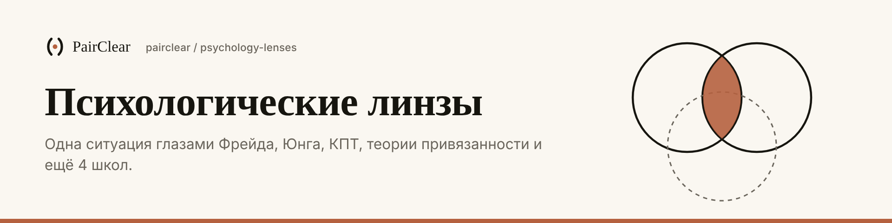
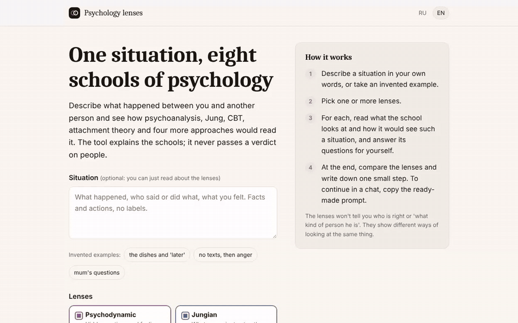
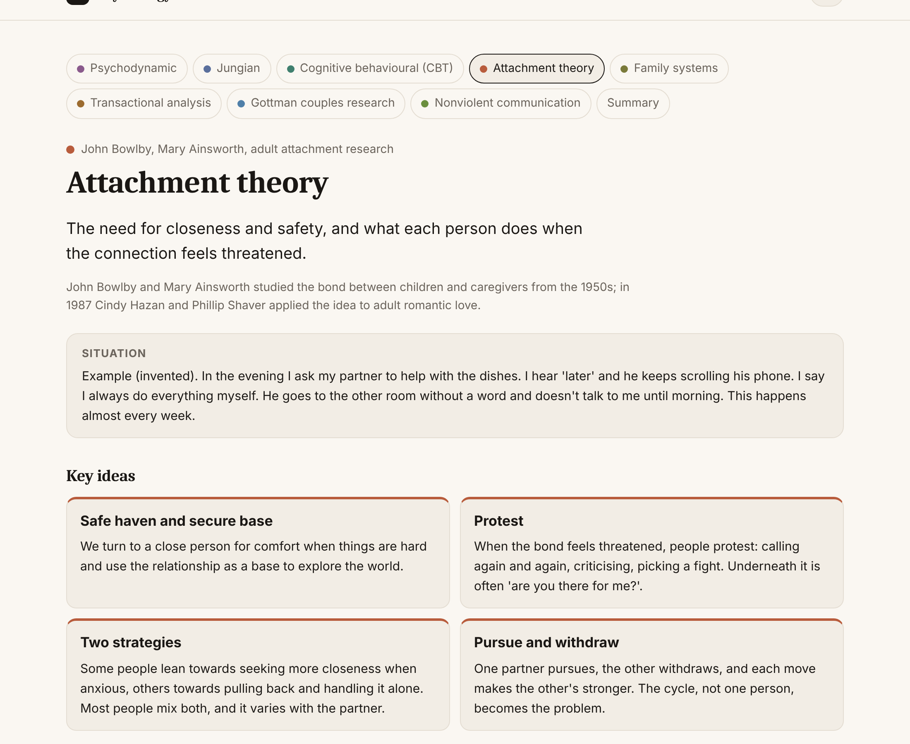

<a href="https://pairclear.github.io/psychology-lenses/?lang=ru"><picture>
  <source media="(prefers-color-scheme: dark)" srcset="assets/banner-dark.ru.png">
  
</picture></a>

# Психологические линзы: разбор ситуации глазами Фрейда, Юнга, КПТ и ещё 5 школ

**[Открыть инструмент →](https://pairclear.github.io/psychology-lenses/?lang=ru)** · [English](README.md) · [Промпты для ChatGPT](prompts/ru/) · [Скилл для Claude](SKILL.md)

   

> **Просвещение, а не диагностика.** Линзы объясняют, как школа психологии посмотрела бы на ситуацию. Они не ставят диагнозов, не навешивают ярлыков, не судят ни тебя, ни других и не заменяют специалиста. Если есть мысли навредить себе или дома есть насилие, позвони в экстренную службу (112) или найди бесплатную линию поддержки на [findahelpline.com](https://findahelpline.com).

## Как это выглядит

**[Открыть в браузере →](https://pairclear.github.io/psychology-lenses/?lang=ru)** Работает без установки, ничего не отправляет.

Чат-боты часто просят: «разбери это по Фрейду» или «что сказал бы Юнг о моих отношениях». Этот репозиторий делает такой запрос честным и полезным: ты описываешь, что произошло между тобой и другим человеком, а каждая линза показывает, на что смотрит её школа, как она прочитала бы такую ситуацию, какие вопросы задала бы тебе и где её ограничения.

## Восемь линз

| Линза | На что смотрит | Промпт |
|---|---|---|
| Психодинамическая (Фрейд и после) | Скрытые мотивы и чувства, старые сценарии, которые повторяются | [RU](prompts/ru/psychodynamic.md) · [EN](prompts/en/psychodynamic.md) |
| Юнгианская | Проекция, тень, роли, которые мы носим | [RU](prompts/ru/jungian.md) · [EN](prompts/en/jungian.md) |
| Когнитивно-поведенческая (КПТ) | Ситуация → мысль → чувство → действие, ловушки мышления | [RU](prompts/ru/cbt.md) · [EN](prompts/en/cbt.md) |
| Теория привязанности | Потребность в близости и безопасности, цикл «догоняю — отстраняюсь» | [RU](prompts/ru/attachment.md) · [EN](prompts/en/attachment.md) |
| Системная семейная | Роли, треугольники, сценарии через поколения | [RU](prompts/ru/family-systems.md) · [EN](prompts/en/family-systems.md) |
| Транзактный анализ | Родитель, Взрослый, Ребёнок; «игры»; треугольник Карпмана | [RU](prompts/ru/transactional-analysis.md) · [EN](prompts/en/transactional-analysis.md) |
| Исследования пар Готтмана | Как начинается разговор, разрушительные паттерны, восстановление | [RU](prompts/ru/gottman.md) · [EN](prompts/en/gottman.md) |
| Ненасильственное общение | Наблюдения, чувства, потребности, просьбы | [RU](prompts/ru/nvc.md) · [EN](prompts/en/nvc.md) |
| **Все линзы со сравнением** | Подбирает 2–3 подходящие линзы и сравнивает прочтения | [RU](prompts/ru/all-lenses.md) · [EN](prompts/en/all-lenses.md) |

У каждой линзы есть раздел **«Ограничения и критика»** и источники. Линза это способ смотреть, а не факт о тебе.

## Как начать

- **В браузере:** открой [инструмент](https://pairclear.github.io/psychology-lenses/?lang=ru). Опиши ситуацию (или возьми выдуманный пример), выбери линзы, ответь на вопросы.
- **Сразу к одной линзе:** добавь `?lens=cbt` (или `psychodynamic`, `jungian`, `attachment`, `family-systems`, `transactional-analysis`, `gottman`, `nvc`).
- **Без интернета:** скачай `index.html` и открой его.
- **В чате:** скопируй промпт из [`prompts/ru/`](prompts/ru/) в ChatGPT, Claude, Gemini, YandexGPT или GigaChat. Или нажми «Промпт» в инструменте: он скопирует линзу вместе с твоей ситуацией и ответами.
- **Как скилл:** добавь [`SKILL.md`](SKILL.md) в скиллы Claude или настройки агента.

## Встроенные ограничения

Каждый промпт и скилл просят чат:

- объяснять школу, а не судить человека: без диагнозов и ярлыков вроде «нарцисс», «токсичный», «созависимая»;
- не судить тех, кого нет в разговоре: «мой муж нарцисс?» превращается в «что он конкретно делает и какие у меня варианты?»;
- подавать каждое прочтение как гипотезу и отказываться от него, если ты говоришь, что не подходит;
- не советовать уйти или остаться;
- считать насилие, угрозы и контроль вопросом безопасности, а не «динамикой, которую создают оба»;
- останавливаться и подсказывать, где помощь, если ты упоминаешь самоповреждение или суицид.

Веб-инструмент к тому же замечает ярлыки и опасные слова **локально, в браузере** и показывает мягкую подсказку: описать действия вместо ярлыков или сначала позаботиться о безопасности.

## Приватность

Всё работает в браузере. Страница не делает сетевых запросов, в ней нет аналитики, cookies и сторонних шрифтов. Ситуация и ответы хранятся только в локальном хранилище браузера, одна кнопка их стирает.

## Устройство репозитория

| Путь | Что это |
|---|---|
| [`lenses.json`](lenses.json) | Все тексты линз на RU и EN: единственный источник правды |
| [`index.html`](index.html) | Инструмент: один сгенерированный HTML-файл без зависимостей |
| [`prompts/`](prompts/) | Сгенерированные промпты: по одному на линзу и один для сравнения |
| [`SKILL.md`](SKILL.md), [`AGENTS.md`](AGENTS.md) | Линзы как скилл для Claude и других агентов |
| `src/`, `scripts/build.mjs` | Шаблон страницы, общие тексты промптов, сборка |

Чтобы поменять текст, правь `lenses.json` или `src/`, затем запусти `node scripts/build.mjs` (Node 18+, без пакетов).

## Вопросы

**Может ли инструмент сказать, нарцисс ли мой партнёр?** Нет, и ничто честное не может сделать это по рассказу. Он поможет описать, что происходит, посмотреть с разных сторон и подумать о своих вариантах.

**Какая линза правильная?** Ни одна не «истина». Они смотрят на разные уровни: внутренний мир, мысли, потребность в близости, семейную систему, способ разговаривать. Часто полезнее всего увидеть, где они сходятся.

**Это терапия?** Нет. Это помощь в саморефлексии. Если ситуация повторяется и ранит, лучший следующий шаг — специалист, работающий в одном из этих подходов.

**Кто написал тексты?** Они написаны с помощью ИИ и сверены с источниками, указанными в каждой линзе. Это упрощение больших и спорных областей.

**Зачем это сайту про отношения?** [PairClear](https://pairclear.com/ru/?utm_source=github&utm_medium=readme&utm_campaign=psychology-lenses) делает короткие тесты про то, что происходит между двумя людьми, тоже в браузере. Линзы — бесплатное дополнение к ним.

## Другие бесплатные инструменты PairClear

| Репозиторий | Что это |
|---|---|
| [16 ассоциаций](https://github.com/pairclear/sixteen-associations) | 16 слов об одной теме, по парам до одного |
| [Дневник отношений](https://github.com/pairclear/reflection-journal) | Вопросы после ссоры, перед трудным разговором, раз в неделю |
| [Мысли после ссоры](https://github.com/pairclear/conflict-thought-diary) | Дневник мыслей (КПТ) для конфликтов в паре |
| [Я не психотерапевт](https://github.com/pairclear/not-a-therapist) | Правила безопасности для ИИ-чатов об отношениях |
| [Опросники об отношениях](https://github.com/pairclear/relationship-questionnaires) | Семь коротких открытых опросников в браузере |
| [Набор для работы с парами](https://github.com/pairclear/couples-counseling-kit) | Шаблоны, домашние задания и ИИ-промпты для специалистов |

Все инструменты и статьи: [pairclear.com](https://pairclear.com/ru/?utm_source=github&utm_medium=readme&utm_campaign=psychology-lenses) · [github.com/pairclear](https://github.com/pairclear)

## Лицензия

Код: [MIT](LICENSE). Тексты и промпты: [CC BY 4.0](LICENSE-TEXT.md).
